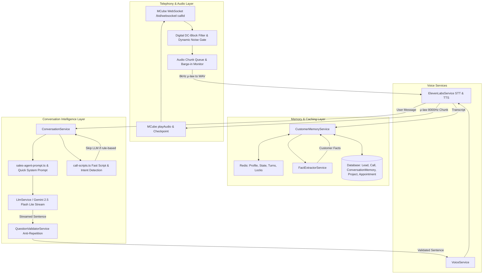

# Aria Real Estate AI Voice Calling CRM — Complete Codebase Audit

**Date:** 2026-11-17  
**System:** Aria AI Voice Sales Advisor (Saya Group)  
**Stack:** NestJS, TypeScript, Prisma (MySQL/PostgreSQL), Redis, Gemini Streaming, ElevenLabs (TTS Flash v2.5 + STT Scribe v2), MCube Bidirectional Telephony WebSocket (μ-law 8000Hz).

---

## 1. Existing Architecture Overview

---

## 2. Existing Service Responsibilities

| Service / Module | File Path | Core Responsibilities |
|---|---|---|
| **McubeStreamService** | `backend/src/calls/mcube-stream.service.ts` | Attaches MCube WS `/bid/websocket/{callId}`. Buffers inbound 8kHz μ-law, executes Dynamic Noise Gate, detects barge-in, schedules flushes, triggers STT, calls ConversationService, schedules thinking fillers, sends `playAudio` & `checkpoint`. |
| **TwilioStreamService** | `backend/src/calls/twilio-stream.service.ts` | Equivalent WebSocket handler for Twilio media streams. |
| **ExotelStreamService** | `backend/src/calls/exotel-stream.service.ts` | Equivalent WebSocket handler for Exotel bidirectional streams. |
| **PhoneAudio Helpers** | `backend/src/calls/phone-audio.ts` | 1st-order IIR DC-block filter (`filterDcBlockPcm16`), μ-law <-> PCM16 conversions, `pcmEnergy` calculation, dynamic noise threshold formulas. |
| **CallScripts** | `backend/src/calls/call-scripts.ts` | Intent detection (`detectIntent`), contextual follow-up builders (`buildFollowUpReply`), thinking fillers bank (`getThinkingFiller`), banned name dictionary (`FORBIDDEN_NAME_WORDS`). |
| **CustomerMemoryService** | `backend/src/memory/customer-memory.service.ts` | Redis & DB cache management for caller profile, conversation state (`ConversationState`), turn recording, facts persistence to `ConversationMemory` and `Lead`. |
| **FactExtractorService** | `backend/src/memory/fact-extractor.service.ts` | Regex & heuristic extraction of BHK, budget, purpose, timeline, location, name, and projects from customer speech. |
| **QuestionValidatorService** | `backend/src/memory/question-validator.service.ts` | Anti-repetition inspection of AI responses against `answeredFields` and `customer` facts before TTS. |
| **ConversationService** | `backend/src/conversation/conversation.service.ts` | Orchestrates conversation turns. Evaluates Fast Script vs LLM path, constructs system prompts with project context and customer facts, streams Gemini LLM tokens, chunks sentences, and runs post-turn qualification. |
| **LlmService** | `backend/src/llm/llm.service.ts` | Handles multi-model Gemini (`gemini-flash-lite-latest`, `gemini-2.5-flash`) and OpenAI chat and streaming via SSE. |
| **VoiceService** | `backend/src/voice/voice.service.ts` | Gateway for TTS and STT, normalizes Indian pronunciation of real-estate place names (`place-names.ts`), dispatches to ElevenLabs. |
| **ElevenLabsService** | `backend/src/elevenlabs/elevenlabs.service.ts` | Direct integration with ElevenLabs REST API: `scribe_v2` for STT with 429 retry backoff, Flash v2.5 for streaming/buffer TTS. |
| **AppointmentsService** | `backend/src/appointments/appointments.service.ts` | Manages site-visit and callback bookings, pushes to Google Calendar (`GoogleCalendarService`), parses slots from speech (`meeting-time.ts`). |
| **AiService** | `backend/src/ai/ai.service.ts` | Manages global `AiAgentSettings` (agent name, voice, language, tone, LLM model, prompt). |
| **ProjectsService** | `backend/src/projects/projects.service.ts` | CRUD and querying of real-estate project inventory. |

---

## 3. End-to-End Conversation & Pipeline Analysis

### A. Inbound Call Audio Pipeline
1. Call connects via MCube: WebSocket route `/bid/websocket/:callId` upgraded in `main.ts` and passed to `McubeStreamService.attachClient`.
2. First 500ms (~25 chunks): Line is sampled by `calculateDynamicNoiseThresholds` to calibrate baseline ambient noise floor and set `voiceThreshold` (min 450) and `bargeThreshold` (min 900).
3. Audio chunks are filtered via `filterDcBlockPcm16` (sub-100Hz rumble attenuation) and buffered.
4. Silence detection fires after 420ms of silence post-speech.
5. Inbound audio is boosted and converted to 16-bit PCM WAV.

### B. Speech-to-Text & Input Filtering
1. Sent to ElevenLabs Scribe v2 STT.
2. Output is stripped of acoustic non-speech annotations (`[background noise]`, `[laughter]`, `[हँसने की आवाज़]`). If no real speech remains, the turn is discarded safely.

### C. Memory & Intent Pipeline
1. `CustomerMemoryService` initializes/retrieves Redis state (`call:${callId}:memory` and `customer:${phone}:profile`).
2. Facts are extracted from the user's utterance via `FactExtractorService.extractFromUtterance` and merged into `session.memory`.
3. Caller turn is recorded in Redis history (`call:${callId}:history`).

### D. Response Generation Pipeline
1. `ConversationService.reply(...)` is called.
2. **Fast Script Path:** For unambiguous short phrases (e.g. standalone "Hello", simple "nahi chahiye"), rule-based templates trigger immediately (0ms).
3. **LLM Streaming Path:** For complex queries, inventory requests, or objections, a prompt with active CRM project inventory, known customer facts, and conversation history is passed to Gemini 2.5 Flash Lite streaming.
4. As sentences complete, `onSentence` triggers `QuestionValidatorService.validateAndSanitize`.

### E. Speech Output & Barge-In Pipeline
1. Validated sentences are queued in `ttsChain`.
2. Audio synthesized via ElevenLabs Flash v2.5 in `ulaw_8000` format.
3. Audio chunk is sent to MCube with `event: 'playAudio'` followed by `event: 'checkpoint'`.
4. If caller speaks during playback (`energy > session.bargeThreshold`), `bargeIn()` immediately fires:
   - Sets `session.cancelPlay = true`
   - Increments `session.flushGen` to abort pending async TTS chains
   - Sends `clearAudio` event to MCube to kill telephony playback instantly.

---

## 4. Existing Problems Discovered

### Problem 1: Disconnected Anti-Repetition Replacement (PART 5)
In `QuestionValidatorService.validateAndSanitize`:
- When a sentence asks a question that is already answered (e.g. customer said "Main ready-to-move dekh raha hoon" and AI asks about timeline or BHK), the service discarded the entire sentence and replaced it with a canned hardcoded question from `getNextUnaskedQuestion` (e.g. *"Aap 2 BHK flat dekh rahe hain ya 3 BHK?"*).
- **Impact:** Disregards the customer's direct question or statement and feels robotic.

### Problem 2: Missing Priority Order for Direct Questions (PART 6)
- When a customer asks a direct question (e.g. *"Tumko kaise pata chala mera budget 80 lakh hai?"* or *"Palace Heights mein amenities kya hain?"*), prompt instructions occasionally encouraged jumping back into qualification fields rather than answering the customer's query first.

### Problem 3: Rigid Qualification Flow & Lack of Missing Facts State (PART 3 & 7)
- Qualification logic in `call-scripts.ts` and `ConversationService` relied on a static sequence (`bhk` -> `possession` -> `visit`).
- It did not maintain an explicit dynamic structure tracking:
  - `knownFacts`
  - `missingFacts`
  - `nextAction`
  - Source tracking (`previous_call` vs `current_call`)
  - Confidence / confirmation state.

### Problem 4: Memory Fact Overwrite / Outdated Information Handling (PART 4)
- When a customer updates their requirements (e.g. budget from 80 Lakh to 1 Crore), the memory service needs to cleanly track `previousValue`, `source: 'customer_correction'`, and update the CRM Lead entity while preserving the history.

### Problem 5: Repeated Customer Name Addressing (PART 8)
- In some turns, the prompt and script combined to address the customer as `"Yuvraj ji"` in consecutive sentences (e.g. *"Namaste Yuvraj ji... boliye Yuvraj ji... Yuvraj ji hamare paas..."*).

---

## 5. Duplicate or Conflicting Logic Identified

1. **Follow-Up Reply Logic duplicated across services:**
   `mcube-stream.service.ts` calls `buildFollowUpReply(...)` synchronously as a default fallback before calling `this.conversation.reply(...)`, which itself internally re-runs `buildFollowUpReply(...)` in certain branches.
2. **Project overview text caching:**
   `conversation.service.ts` has a local in-memory 60-second cache (`cachedProjectsOverview`), while `ProjectsService` is the source of truth. We should ensure the overview is formatted cleanly with distinct Residential vs Commercial categories.
3. **Meeting request detection:**
   `looksLikeMeetingRequest` was in `meeting-time.ts`, while regex matching for visit days was also scattered in `call-scripts.ts` and `conversation.service.ts`.

---

## 6. Proposed File-Level Changes & Upgrades

1. **`backend/src/memory/memory.types.ts`**:
   - Upgrade `CustomerFacts` & `FactEntry` to track `source: 'previous_call' | 'current_call' | 'customer' | 'crm'`, `confirmed: boolean`, `timestamp: number`, `previousValue`.
   - Add `MissingFact` and `NextAction` types.
2. **`backend/src/memory/customer-memory.service.ts`**:
   - Separate historical profile facts from current call updates.
   - Support fact corrections and update CRM leads cleanly.
   - Add helper `getConversationFactContext()` providing structured `knownFacts`, `missingFacts`, and `nextAction`.
3. **`backend/src/memory/question-validator.service.ts`**:
   - Stop replacing valid informational responses with unrelated canned questions.
   - Strip only the offending repeated question clause while keeping the informational answer.
   - Regenerate contextually relevant next questions based on the customer's latest utterance and `missingFacts`.
4. **`backend/src/conversation/conversation.service.ts`**:
   - Enforce Direct Question Answering priority (Priority 1: Direct Answer -> Priority 2: Customer Intent -> Priority 3: Missing Qualification -> Priority 4: Recommendation -> Priority 5: Site Visit).
   - Inject structured memory context and dynamic missing facts into prompt.
   - Prevent customer name repetition in consecutive sentences.
   - Organize project inventory into Residential vs Commercial buckets.
5. **`backend/src/calls/call-scripts.ts`**:
   - Ensure `detectIntent` and `buildFollowUpReply` respect returning customer facts and do not restart discovery.
6. **`backend/src/calls/mcube-stream.service.ts`**:
   - Enhance queue cancellation and generation tracking on customer barge-in.
   - Structured turn logging (turn count, detected intent, facts extracted, latency).
