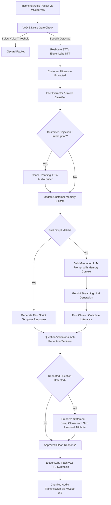
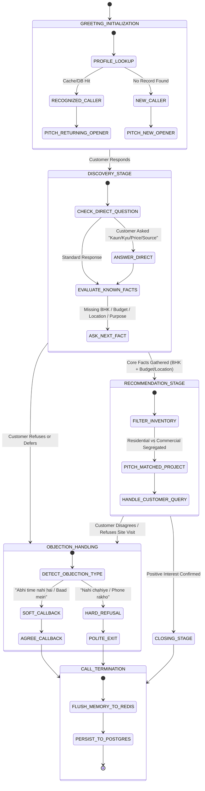

# Aria Conversational Flow & State Machine Architecture

## 1. Executive Summary

This document specifies the conversation lifecycle, turn processing mechanics, routing hierarchy, and fallback mechanisms for **Aria**, the AI Real Estate Sales Advisor representing **Saya Group**.

Aria is built to operate over bidirectional 8kHz μ-law WebSocket audio streams (MCube telephony) with sub-second response times. Her conversational flow balances structured sales qualification with fluid, human-like dialogue, ensuring no repetitive questioning and strict factual adherence.

---

## 2. High-Level Turn Pipeline Flowchart

---

## 3. Conversational State Machine

---

## 4. Step-by-Step Stage Specifications

### Stage 1: Call Initialization & Customer Recognition
1. **Audio Handshake:**
   - MCube opens WebSocket at `/bid/websocket/{callId}`.
   - Initial 500ms calculates ambient noise floor to dynamically calibrate energy threshold (default ~450, auto-scaled up to 700 in noisy lines).
2. **Identity Resolution:**
   - Phone number normalized via `normalizePhoneNumber(rawPhone)`.
   - Redis profile queried at `customer:{phone}` (TTL 3600s).
   - If Redis miss, PostgreSQL queried (`prisma.lead.findFirst`).
3. **Opener Selection:**
   - **Returning Customer:** Recognizes name, previous BHK, budget, and call history. Welcomes back warmly:
     - *Hinglish:* `"Namaste [Name] ji! Saya Group mein aapka phir se swaagat hai. Pichhli baar hamari baat [2 BHK] ko lekar hui thi — kya aaj usi ke regarding baat karna chahenge ya kuch naya dekhna hai?"`
     - All previous facts stamped with `source: 'previous_call'`.
   - **New Customer:** Neutral polite greeting without assuming name or requirements:
     - *Hinglish:* `"Haan ji namaste! Saya Group helpline mein aapka swaagat hai. Main Aria baat kar rahi hoon, bataiye main aapki kya sahayata kar sakti hoon?"`

### Stage 2: Direct Question Answering vs Qualification Discovery
When the customer responds, Aria classifies their intent before deciding whether to ask a question:
- **Direct Question Priority:**
  - If customer asks *"Aap kaun bol rahe ho?"* ➔ Identify Aria and Saya Group immediately.
  - If customer asks *"Tumko kaise pata chala mera budget 80 Lakh hai?"* ➔ Explain directly: *"Ji pichhli call par humari baat hui thi, tabhi se system mein record hai."*
  - If customer asks about pricing or inventory ➔ Answer with factual ranges before asking follow-ups.
- **Qualification Rule:**
  - At most **ONE** question per turn.
  - Never ask for an attribute that already exists in `factContext.knownFacts`.

### Stage 3: Inventory Presentation & Segregation
- **Residential Segregation:**
  - Residential queries (flats, apartments, BHK) only map to:
    - *Saya Gold Avenue* (Indirapuram, Ready to Move, 2/3/4 BHK)
    - *Saya Zenith* (Indirapuram, 2/3/4 BHK)
    - *Saya Zion* (Greater Noida West, 2/3/4 BHK)
    - *Saya South X (Residential/Suites)* (Greater Noida West)
- **Commercial Segregation:**
  - Commercial queries (shops, retail, offices, food court) strictly map to:
    - *Saya South X* (Greater Noida West, High Street Retail)
    - *Saya Piazza* (Jaypee Wish Town, Sector 131 Noida)
  - Commercial projects are **never** offered to callers seeking residential homes.

### Stage 4: Anti-Repetition Sanitization Layer
Before any generated response reaches TTS:
1. `QuestionValidatorService.validateAndSanitize(response, state)` evaluates the text against regex detectors (`bhk`, `budget`, `purpose`, `location`, `timeline`).
2. If the response contains a question for an already-known fact:
   - `allowed = false`.
   - The informational statement/prefix is preserved.
   - The redundant question clause is stripped and replaced with `getNextUnaskedQuestion(state)` (e.g. asking for missing location or possession).
   - Logged with `[Anti-Repetition]` warning.

### Stage 5: Interruption & Barge-In Handling
1. While Aria is speaking, incoming audio is continuously analyzed for speech energy above `bargeThreshold` (~900).
2. Upon customer speech confirmation (energy sustained > 200ms):
   - Active TTS stream to ElevenLabs is immediately aborted.
   - MCube `clearAudio` or playback flush signal is issued.
   - Telephony stream clears pending buffers.
   - Customer utterance is transcribed and fed into the turn pipeline without latency accumulation.

### Stage 6: Call Termination & Persistence
1. Customer says goodbye or disconnects WebSocket.
2. `CustomerMemoryService.persistMemoryToDb(callId)` executes:
   - Upserts `ConversationMemory` with `customerFacts`, `answeredFields`, `askedQuestions`.
   - Updates `Lead` table with verified requirements.
   - Updates Redis profile cache `customer:{phone}` for future returning calls.
