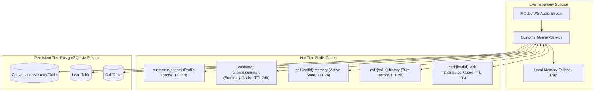
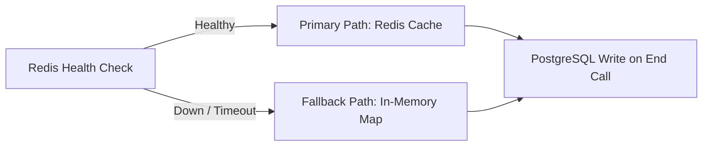

# Aria Customer Memory Architecture & Data Persistence

## 1. Overview

The **Aria Customer Memory Architecture** is a dual-tier (Redis cache + PostgreSQL/Prisma DB) state management system engineered for high-concurrency real-estate voice agents. It guarantees zero fact degradation across call sessions, provides instant caller context injection (< 5ms retrieval), and ensures complete data persistence even during abnormal WebSocket disconnects.

---

## 2. Architecture Diagram



---

## 3. Storage Keys & Schemas

### 3.1 Redis Hot Cache Keys

| Key Pattern | Data Type | TTL | Purpose | Sample Value / Structure |
| :--- | :--- | :--- | :--- | :--- |
| `customer:{phone}` | String (JSON) | 3600s (1h) | Cached profile for sub-second recognition on incoming calls | `{"leadId":"lead_1","name":"Yuvraj","bhk":"2 BHK","budget":8000000,"budgetLabel":"80 Lakh","previousCallCount":3}` |
| `customer:{phone}:summary` | String (Plain/JSON) | 86400s (24h) | Compact natural-language summary of past discussions | `"Customer interested in 2 BHK under 80 Lakhs in Ghaziabad. Discussed Saya Gold Avenue."` |
| `call:{callId}:memory` | String (JSON) | 7200s (2h) | Full active state of current call | Full `ConversationState` object including `factContext`, `confirmedFacts`, `answeredFields` |
| `call:{callId}:history` | List (JSON strings) | 7200s (2h) | FIFO list of last 20 conversation turns (user & assistant) | `[{"role":"user","text":"Hello","timestamp":1731800000}, ...]` |
| `lead:{leadId}:lock` | String (Token) | 10s | Distributed mutex lock preventing race conditions on concurrent leads | `"uuid-v4-token"` |

### 3.2 Persistent PostgreSQL Database (Prisma Models)

```prisma
model ConversationMemory {
  id                  String    @id @default(cuid())
  callId              String    @unique
  leadId              String?
  customerFacts       Json?     // Stores full CustomerFacts object
  askedQuestions      Json?     // Array of asked questions
  answeredFields      Json?     // Array of answered fields ['bhk', 'budget', ...]
  pendingQuestion     String?
  lastIntent          String?
  conversationStage   String?
  conversationSummary String?
  createdAt           DateTime  @default(now())
  updatedAt           DateTime  @updatedAt
  lead                Lead?     @relation(fields: [leadId], references: [id])
}

model Lead {
  id                 String               @id @default(cuid())
  phone              String
  name               String?
  budget             Float?
  bhkPreference      String?
  preferredLocation  String?
  purchaseTimeline   String?
  siteVisitInterest  Boolean              @default(false)
  aiSummary          String?
  memories           ConversationMemory[]
  calls              Call[]
}
```

---

## 4. Fact Lifecycle & Source Stamping

Every customer requirement or preference extracted during a conversation is tracked as a structured fact entry:

```typescript
export interface FactEntry {
  value: any;
  confidence: 'confirmed' | 'approximate';
  extractedAt: number;
  source: 'previous_call' | 'current_call' | 'customer' | 'crm' | 'inference';
  previousValue?: any;
  rawSnippet?: string;
}
```

### Fact Transition Matrix:
1. **Initial Hydration (Call Start):**
   - Profile loaded from Redis or DB.
   - Facts existing prior to the call are marked: `source: 'previous_call'`.
   - `factContext.knownFacts` populated immediately.
2. **Current Turn Extraction:**
   - Fact extracted from user utterance.
   - Marked: `source: 'current_call'`.
   - If the fact existed previously (e.g. Budget changed from 80 Lakh to 90 Lakh):
     - `previousValue: '80 Lakh'` is preserved.
     - `value: '90 Lakh'` is saved.
     - Prompt generation gains explicit context: *"Customer revised budget from 80 Lakh to 90 Lakh"*.
3. **Persisted State:**
   - Stored in `ConversationMemory` and synced back to `Lead` and Redis profile cache on call completion.

---

## 5. Concurrent Call Isolation Guarantees

In multi-line telephony systems, multiple inbound and outbound calls may occur simultaneously on the same or different phone numbers.

- **Per-Call State Isolation:**
  - Every active call is keyed exclusively by its unique `callId`.
  - In-memory fallback (`localMemoryFallback`) uses a `Map<callId, ConversationState>`.
  - Updating state in `call-1` has zero mathematical or operational impact on `call-2`.
- **Distributed Mutex for Profile Updates:**
  - When persisting to shared customer records, `acquireLeadLock(leadId, 10)` ensures that concurrent calls for the same lead do not overwrite each other with stale reads.

---

## 6. Resilience & Graceful Fallback Strategy



1. **Redis Unavailable:**
   - When Redis disconnects or is unavailable, `CustomerMemoryService` catches the exception, logs a warning, and seamlessly falls back to `localMemoryFallback` and `localHistoryFallback`.
   - Calls continue uninterrupted with zero user-perceivable lag.
2. **Abnormal Disconnect:**
   - When WebSocket `onClose` fires prematurely, `persistMemoryToDb(callId)` is invoked in the connection teardown handler, ensuring all facts collected up to the last second are committed to PostgreSQL.
