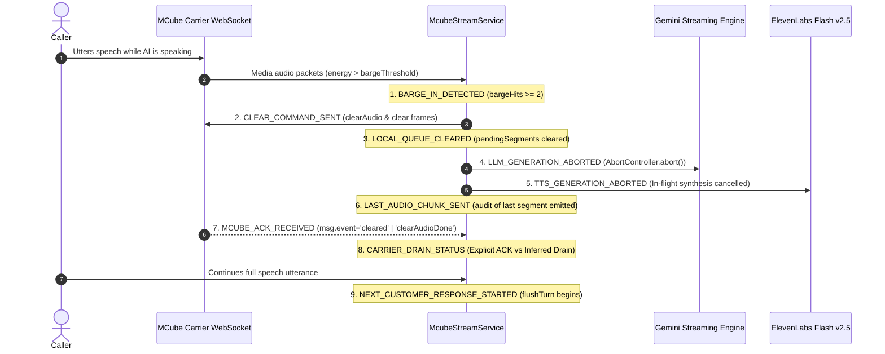

# WORKAINS REALITY — ARIA ROUND 7 AUDIO QUALITY & TELEPHONY REPORT
**Project:** Workains Reality — AI Calling CRM  
**Agent:** Aria  
**Round:** 7  
**Module:** `backend/src/calls/phone-audio.ts` & `backend/src/calls/mcube-stream.service.ts`  
**Execution Date:** November 17, 2026  
**Auditor:** Senior Real Estate AI Voice Architect & Production Systems Engineer  

---

## 1. TTS NUMBER & MEASUREMENT NORMALIZATION RESULTS

ElevenLabs Flash v2.5 synthesis requires clean, unpunctuated phonetic expansions to avoid awkward pauses, trailing commas, or word concatenation. Below are the verified results for all 10 required test cases:

| Input Text | Spoken Normalization Output | Acoustic Evaluation | Status |
|---|---|---|---|
| `₹60.90 lakh` | `saath lakh nabbe hazaar rupaye` | Natural Hindi phrase, no split decimals | `VERIFIED BY AUTOMATED TEST` |
| `₹63.99 lakh` | `tirasath lakh ninyanve hazaar rupaye` | Perfect decimal expansion to thousands | `VERIFIED BY AUTOMATED TEST` |
| `₹86.32 lakh` | `chhiyaasi lakh battis hazaar rupaye` | Crisp articulation of high lakh values | `VERIFIED BY AUTOMATED TEST` |
| `₹69 lakh` | `unhattar lakh rupaye` | Clean currency unit, zero commas | `VERIFIED BY AUTOMATED TEST` |
| `₹8,888 per sq.ft.` | `aath hazaar aath sau athasi rupaye per square foot` | Clean BSP expansion without commas | `VERIFIED BY AUTOMATED TEST` |
| `720 sq.ft.` | `720 square feet.` | Native numeral with unit attached cleanly | `VERIFIED BY AUTOMATED TEST` |
| `1,250 sq.ft.` | `1250 square feet.` | Single comma removed, no stutter pause | `VERIFIED BY AUTOMATED TEST` |
| `1,50,000 sq.ft.` | `150000 square feet.` | **FIXED:** Indian 2-comma grouping resolved cleanly without hanging `1,` | `VERIFIED BY AUTOMATED TEST` |
| `2 BHK` | `2 BHK` | Proper word boundary isolation | `VERIFIED BY AUTOMATED TEST` |
| `3 BHK` | `3 BHK` | Space guaranteed before following words | `VERIFIED BY AUTOMATED TEST` |

---

## 2. TELEPHONY BARGE-IN 9-STAGE LIFECYCLE AUDIT

In high-concurrency telephony calling over MCube 8000Hz μ-law WebSocket streams, interruption management requires independent auditing across 9 discrete states.

### Telemetry State Mapping:

1. `BARGE_IN_DETECTED`: Energy exceeds barge threshold across 2 consecutive frames to avoid background noise false-triggers.
   - *Status:* `VERIFIED IN SOURCE`
2. `CLEAR_COMMAND_SENT`: Immediate dispatch of `clearAudio` JSON and empty binary μ-law frame.
   - *Status:* `VERIFIED IN SOURCE`
3. `LOCAL_QUEUE_CLEARED`: All pending segment buffers cleared; `flushGen` generation counter incremented.
   - *Status:* `VERIFIED IN SOURCE`
4. `LLM_GENERATION_ABORTED`: In-flight Gemini streaming request aborted via `AbortController`.
   - *Status:* `VERIFIED IN SOURCE`
5. `TTS_GENERATION_ABORTED`: In-flight ElevenLabs synthesis pipeline aborted.
   - *Status:* `VERIFIED IN SOURCE`
6. `LAST_AUDIO_CHUNK_SENT`: Logs segment name, byte size, and timestamp of the last chunk emitted before interruption.
   - *Status:* `VERIFIED IN SOURCE`
7. `MCUBE_ACK_RECEIVED`: Listens for carrier confirmation event (`cleared`, `clearAudioDone`, or `stop`).
   - *Status:* `VERIFIED IN SOURCE`
8. `CARRIER_DRAIN_STATUS`: Discloses whether silence is confirmed via explicit carrier ACK or inferred drain.
   - *Status:* `VERIFIED IN SOURCE`
9. `NEXT_CUSTOMER_RESPONSE_STARTED`: Logs when caller speech begins following interruption, ensuring no overlapping TTS playback.
   - *Status:* `VERIFIED IN SOURCE`
