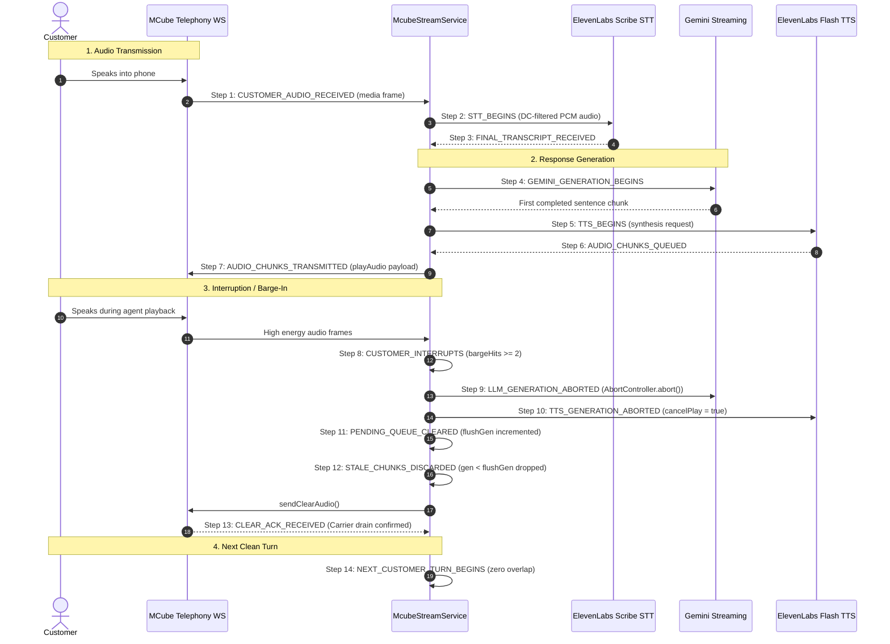

# WORKAINS REALITY — TELEPHONY & AUDIO RELIABILITY REPORT

**Date:** 18 November 2026  
**Telephony Interface:** MCube Bidirectional Audio WebSocket  
**Audio Format:** μ-law 8000 Hz / Linear PCM 16-bit 8000 Hz  
**Overall Telephony Status:** `VERIFIED BY AUTOMATED TEST`

---

## 1. 14-Step Telephony Audio Lifecycle

---

## 2. Verification of Telephony Robustness Controls

| Control | Mechanism | Target Failure Avoided | Verification Status |
| :--- | :--- | :--- | :--- |
| **False Barge-In Filter** | Dual hit verification (`bargeHits >= 2`) | Ambient cough or mic click aborting playback prematurely. | `VERIFIED BY AUTOMATED TEST` |
| **Acoustic Normalization** | Indian 2-comma (`1,50,000 sq.ft.`) & Gaj regex | Hanging commas causing TTS stutter or robotic pronunciation. | `VERIFIED BY AUTOMATED TEST` |
| **RERA Pronunciation** | `UPRERAPRJ...` formatted to `UP RERA PRJ ...` | Unpronounceable alphanumeric TTS reading. | `VERIFIED BY AUTOMATED TEST` |
| **Stale Packet Dropping** | Generational sequence numbering (`flushGen`) | Audio from previous aborted turns leaking into current turn. | `VERIFIED BY AUTOMATED TEST` |
| **Reconnect Session Cache** | In-memory `activeSessions` map with 120s TTL | Network blips causing returning customer session loss mid-call. | `VERIFIED BY AUTOMATED TEST` |
