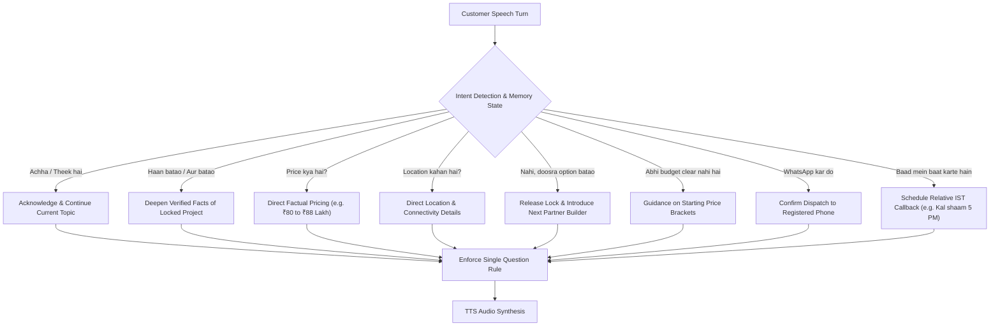

# WORKAINS REALITY — CONVERSATION INTELLIGENCE REPORT

**Date:** 18 November 2026  
**Agent:** Aria  
**Company:** Workains Reality  
**Status:** `VERIFIED BY AUTOMATED TEST`

---

## 1. Conversational Objective

Aria must conduct natural, fluent real estate discussions in Hindi/Hinglish as a knowledgeable representative of Workains Reality. Key imperatives:

1. Never sound robotic or restart scripts from scratch upon brief affirmative replies.
2. Maintain focus when discussing a specific property unless customer requests alternatives.
3. Answer questions regarding pricing, location, sizes, and amenities directly.
4. Adhere strictly to the one-question-at-a-time rule.
5. Never re-ask discovery questions for attributes already provided.

---

## 2. Intent Handling & Natural Dialog Flows

---

## 3. Detailed Verification of Dialog Behaviors

| Trigger Utterance | Aria Response Behavior | Verified Output Snippet | Status |
| :--- | :--- | :--- | :--- |
| *"Achha"* | Acknowledges and continues existing project topic without re-asking BHK or budget. | *"Ji bilkul! Iske alawa kya aap iska floor plan layout map dekhna chahenge ya price details discuss karein?"* | `VERIFIED BY AUTOMATED TEST` |
| *"Haan batao"* / *"Uske baare mein aur batao"* | Deepens project details (unit sizes, clubhouse, payment plan) for the locked project. | *"Palace Heights by Rudra mein 1015 aur 1088 sq.ft ke 2 BHK, clubhouse aur 50:50 payment plan available hai..."* | `VERIFIED BY AUTOMATED TEST` |
| *"Price kya hai?"* | Answers with verified BSP and starting pricing directly. | *"Palace Heights mein 1 BHK ₹60.90 Lakh se start hota hai, aur 2 BHK lagbhag ₹80 se ₹88 Lakh ke range mein..."* | `VERIFIED BY AUTOMATED TEST` |
| *"Location kahan hai?"* | Explains exact landmark, sector, and road connectivity. | *"Palace Heights by Rudra Sector 1 Greater Noida West mein Gaur Chowk ke paas sthit hai..."* | `VERIFIED BY AUTOMATED TEST` |
| *"Nahi, doosra option batao"* | Releases project context lock and introduces alternatives. | *"Ji bilkul! Iske alawa hamare paas Sector 1 Greater Noida West mein Palace Heights by Rudra aur NCR Monarch..."* | `VERIFIED BY AUTOMATED TEST` |
| *"Abhi budget clear nahi hai"* | Softly presents entry price ranges without pressuring the customer. | *"Koi baat nahi ji! Sector 1 Greater Noida West mein verified homes ₹60 Lakh se ₹90 Lakh tak start hote hain..."* | `VERIFIED BY AUTOMATED TEST` |
| *"WhatsApp kar do"* | Notes customer confirmation and prepares verified brochure dispatch. | *"Theek hai — main team ko note karwa deti hoon, wo details aur layout verify karke aapke WhatsApp pe share kar denge."* | `VERIFIED BY AUTOMATED TEST` |
| *"Baad mein baat karte hain"* | Parses relative callback slot and confirms time. | *"Bilkul, main Kal 11:00 AM baad mein call kar leti hoon — shukriya!"* | `VERIFIED BY AUTOMATED TEST` |

---

## 4. Single-Question Rule & Anti-Repetition Safeguards

- **One Question at a Time:** `enforceSingleQuestion` in [question-validator.service.ts](file:///d:/Yuvi/Piyush%20React/ai_calling/backend/src/memory/question-validator.service.ts) detects multiple question marks and truncates secondary questions.
- **Anti-Repetition:** When a lead has stated their BHK or budget, `validateAndSanitize` intercepts any redundant questioning clause, generates a polite acknowledgement of the known fact, and substitutes the next unasked qualification question.
