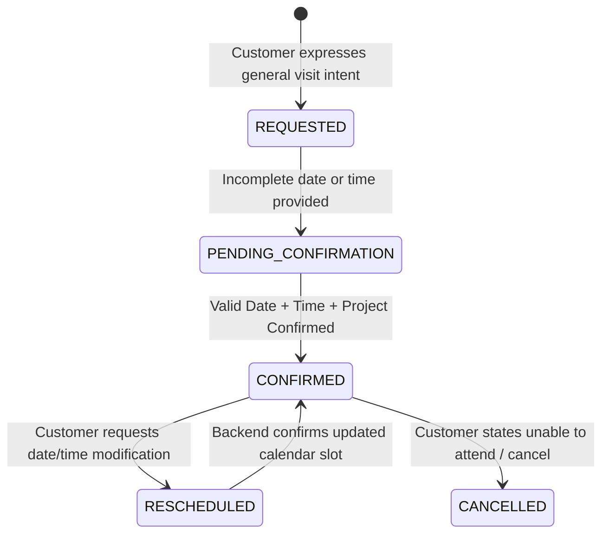

# WORKAINS REALITY — LEAD CONVERSION & QUALIFICATION REPORT

**Date:** 18 November 2026  
**Agent:** Aria  
**Company:** Workains Reality  
**Status:** `VERIFIED BY AUTOMATED TEST`

---

## 1. Transparent Lead Qualification Matrix

Previous versions calculated lead interest with an arbitrary baseline of 4 points on call connect. Round 8 introduces a deterministic, 100-point weighted attribute scoring model.

### 1.1 Attribute Weighting Breakdown

| Criteria | Max Points | Verification Requirements | Evidence Source |
| :--- | :---: | :--- | :--- |
| **BHK Preference** | **20** | Explicit confirmation of 1, 2, 3, 4 BHK or configuration. | `customer_explicit` / `prior_transcript` / `crm_profile` |
| **Budget Preference** | **20** | Stated budget in Lakhs or Crores (e.g. ₹80 Lakh). | `customer_explicit` / `prior_transcript` / `crm_profile` |
| **Preferred Location** | **15** | Specific micro-market (e.g. Greater Noida West, Sector 1). | `customer_explicit` / `prior_transcript` / `crm_profile` |
| **Timeline / Possession** | **15** | Stated time horizon (Ready to Move, Under Construction, 6 months). | `customer_explicit` / `prior_transcript` / `crm_profile` |
| **Purchase Purpose** | **10** | Purpose identified as End-Use (self) or Investment. | `customer_explicit` / `prior_transcript` / `crm_profile` |
| **Site Visit / Meeting** | **20** | Explicit visit interest expressed or appointment scheduled. | `customer_explicit` / `prior_transcript` |
| **Engagement Bonus** | **10** | Lead conversation turns >= 3 (+5 pts), >= 6 (+10 pts). | Transcript conversation turn count |
| **Total Available** | **100** | **Qualification Threshold: Score >= 60 Points** | Normalized to 0–10 integer scale |

---

## 2. Site Visit Conversion Workflow

### Safety Rules:
1. **No Auto-Booking on Generic Ack:** Utterances like *"theek hai"*, *"haan ji"*, *"achha"* are mapped to `REQUESTED` and prompt for explicit slot confirmation.
2. **Rescheduling Protection:** Rescheduling updates existing appointment in-place without generating orphaned duplicates.
3. **Cancellation Handling:** Explicit cancellation marks appointment `CANCELLED` in CRM.

---

## 3. Callback Scheduling & Relative Time Resolution

1. **Relative Date/Time Extraction:**
   - *"kal"* / *"tomorrow"* -> Next calendar day in Asia/Kolkata timezone.
   - *"kal shaam 5 baje"* -> Next calendar day at 17:00:00+05:30.
   - *"parso"* -> Base date + 2 days in Asia/Kolkata timezone.
2. **Duplicate Avoidance:** Leads requesting a callback update their `callbackAt` timestamp on the existing lead entity.
3. **DNC / Opt-Out Compliance:** Negative commands (*"mat call karo"*, *"do not call"*) automatically set `doNotCall: true` and `consentToCall: false` on the lead record.
